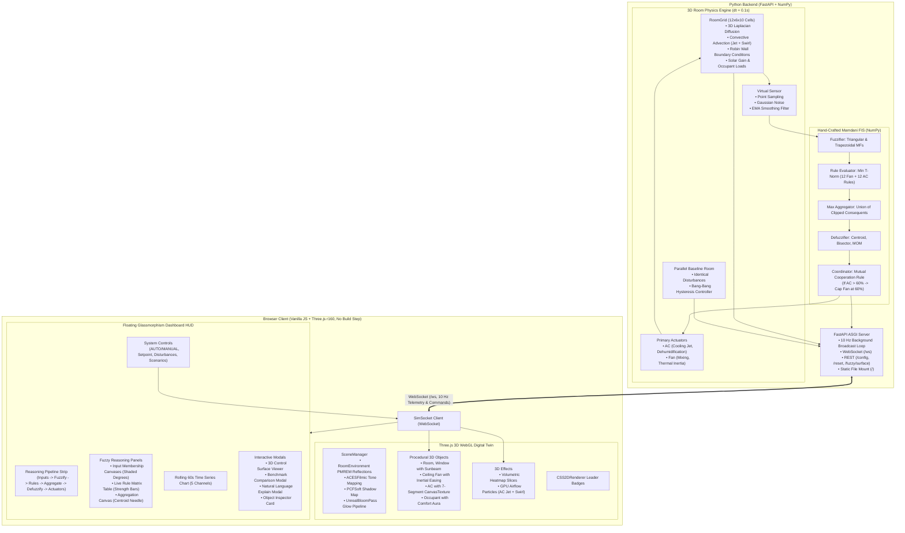

# Fuzzy-Room: 3D Mamdani Digital Twin & Physics Simulator

[](https://www.python.org/)
[](https://fastapi.tiangolo.com)
[](https://threejs.org/)
[](https://numpy.org/)
[](https://pytest.org/)

**Fuzzy-Room** is a full-stack digital twin room simulator where an air conditioner and ceiling fan are orchestrated by a hand-crafted **Mamdani Fuzzy Inference System (FIS)** implemented entirely from scratch in **pure NumPy** (no fuzzy logic libraries in the control loop). The system streams live room physics and every step of fuzzy reasoning to a **Three.js** 3D WebGL dashboard over a bidirectional 10 Hz WebSocket.

Built as an academic university AI / Control Systems project, the application demonstrates continuous linguistic control, mutual device coordination, 3D fluid/thermal convective simulation, and benchmarking against a parallel bang-bang thermostat baseline.

---

## Table of Contents
1. [Visual Showcase](#visual-showcase)
2. [System Architecture](#system-architecture)
3. [How the Fuzzy Logic Works (AI Report Narrative)](#how-the-fuzzy-logic-works-ai-report-narrative)
   - [Discretized Universe & Linguistic Variables](#1-discretized-universe--linguistic-variables)
   - [Membership Functions (Triangular & Trapezoidal)](#2-membership-functions)
   - [Fuzzification & T-Norm Min Conjunction](#3-fuzzification--min-t-norm-rule-firing)
   - [Mamdani Implication & Max Aggregation](#4-mamdani-implication--max-aggregation)
   - [Defuzzification Methods (Centroid, Bisector, MOM)](#5-defuzzification-methods)
   - [Device Mutual Coordination Rule](#6-device-mutual-coordination-rule)
4. [3D Room Physics Simulation](#3d-room-physics-simulation)
5. [Quick Start & Setup Instructions](#quick-start--setup-instructions)
6. [Interactive UI Guide & Keyboard Shortcuts](#interactive-ui-guide--keyboard-shortcuts)
7. [Automated Test Suite & Validation](#automated-test-suite--validation)
8. [Comparative Benchmark: Fuzzy FIS vs. Bang-Bang Baseline](#comparative-benchmark-fuzzy-fis-vs-bang-bang-baseline)
9. [Project File Structure](#project-file-structure)

---

## Visual Showcase

| View | Description |
|---|---|
| **3D Digital Twin Environment** | Transparent architectural walls, reflective floor grid, window with sunbeam, ceiling fan with aerodynamic blades & downrod, split AC with dynamic 7-segment digital display, and stylized mannequin occupant with responsive ground comfort aura. |
| **Volumetric 3D Heatmap** | Multi-planar horizontal slices ($0.75\,\text{m}$, $1.5\,\text{m}$, $2.25\,\text{m}$) interpolating the $12 \times 6 \times 10$ room temperature scalar field with smooth thermal color grading. |
| **GPU Airflow Particles** | Directional cold-air jet streaming from AC louvers across the room (curving downward due to negative thermal buoyancy) and downward helical swirl vortex beneath fan blades. |
| **Mamdani Reasoning Panels** | Live HTML5 Canvas 2D curves for input variables with shaded activation areas, 12-rule matrix with animated firing strength bars, max-aggregated area, and vertical Centroid / Bisector / MOM defuzzification needles. |
| **3D Control Surface Viewer** | Orbitable 3D Three.js mesh populated dynamically via `/fuzzy/surface` ($25 \times 25$ grid) with live red operating marker tracking real-time sensor inputs. |
| **Fuzzy vs. Thermostat Benchmark** | Side-by-side comparison modal evaluating comfort time ratio, cumulative energy (kWh), and compressor switching wear against the parallel hysteresis baseline. |

---

## System Architecture



---

## How the Fuzzy Logic Works (AI Report Narrative)

The fuzzy logic controller implements a generic, mathematically rigorous **Mamdani Fuzzy Inference System (FIS)** written from scratch in NumPy without relying on third-party fuzzy libraries.

### 1. Discretized Universe & Linguistic Variables
Each continuous physical input and output variable is discretized over an evenly spaced universe of discourse $X = \{x_1, x_2, \dots, x_N\}$ with $N = 501$ points:
- **Temperature ($T$)**: Universe $[0, 50]^\circ\text{C}$
- **Humidity ($H$)**: Universe $[0, 100]\%$
- **Temperature Error ($e = T - T_{\text{setpoint}}$)**: Universe $[-10, +15]^\circ\text{C}$
- **Fan Speed ($F$)**: Universe $[0, 100]\%$
- **Cooling Power ($P_{\text{AC}}$)**: Universe $[0, 100]\%$

### 2. Membership Functions
Membership functions are evaluated over the universe vector using vectorized NumPy operations:

#### Triangular Membership Function: $\text{trimf}(x; a, b, c)$
$$\mu(x) = \max\left(0, \min\left(\frac{x - a}{b - a}, \frac{c - x}{c - b}\right)\right)$$

#### Trapezoidal Membership Function: $\text{trapmf}(x; a, b, c, d)$
$$\mu(x) = \max\left(0, \min\left(\frac{x - a}{b - a}, 1, \frac{d - x}{d - c}\right)\right)$$
To match standard industry implementations (`scikit-fuzzy`) down to float machine precision ($10^{-14}$), open shoulder boundaries ($a=b$ for left shoulder; $c=d$ for right shoulder) are clamped to 1.0 within their boundary domains.

#### Linguistic Variable Partitions
- **Fan Temperature Input**:
  - `Cold`: $\text{trap}(0, 0, 10, 18)$
  - `Cool`: $\text{tri}(12, 19, 26)$
  - `Warm`: $\text{tri}(22, 28, 34)$
  - `Hot`: $\text{trap}(30, 36, 50, 50)$
- **Humidity Input**:
  - `Dry`: $\text{trap}(0, 0, 25, 45)$
  - `Comfortable`: $\text{tri}(30, 50, 70)$
  - `Humid`: $\text{trap}(55, 75, 100, 100)$
- **AC Temperature Error Input ($e = T - T_{\text{setpoint}}$)**:
  - `Below`: $\text{trap}(-10, -10, -3, 0)$
  - `OnTarget`: $\text{tri}(-2, 0, 2)$
  - `Above`: $\text{tri}(1, 4, 8)$
  - `WayAbove`: $\text{trap}(6, 10, 15, 15)$
- **Fan Speed Output**:
  - `Off`: $\text{trap}(0, 0, 5, 15)$
  - `Slow`: $\text{tri}(10, 30, 50)$
  - `Medium`: $\text{tri}(40, 60, 80)$
  - `Fast`: $\text{trap}(70, 85, 100, 100)$
- **AC Cooling Power Output**:
  - `Off`: $\text{trap}(0, 0, 5, 15)$
  - `Low`: $\text{tri}(10, 30, 50)$
  - `Medium`: $\text{tri}(40, 60, 80)$
  - `High`: $\text{trap}(70, 85, 100, 100)$

### 3. Fuzzification & Min T-Norm Rule Firing
Given crisp inputs (e.g. $T = 26.5^\circ\text{C}, H = 60.0\%$), the fuzzifier evaluates membership degrees across all fuzzy sets.

For each rule $k$ of the form:
$$\text{IF } x_1 \text{ IS } A_{1,k} \text{ AND } x_2 \text{ IS } A_{2,k} \text{ THEN } y \text{ IS } C_k$$
The firing strength $\alpha_k$ is computed using the **Gödel (min) T-norm**:
$$\alpha_k = \min(\mu_{A_{1,k}}(x_1), \mu_{A_{2,k}}(x_2))$$

#### Complete 12-Rule Matrices
**Fan Rule Base ($4 \times 3 = 12$ rules)**:
| Temperature $\backslash$ Humidity | Dry | Comfortable | Humid |
|---|---|---|---|
| **Cold** | Off | Off | Slow |
| **Cool** | Off | Slow | Slow |
| **Warm** | Slow | Medium | Medium |
| **Hot** | Medium | Fast | Fast |

**AC Rule Base ($4 \times 3 = 12$ rules)**:
| Temp Error $\backslash$ Humidity | Dry | Comfortable | Humid |
|---|---|---|---|
| **Below** | Off | Off | Off |
| **OnTarget** | Off | Low | Low |
| **Above** | Low | Medium | High |
| **WayAbove** | Medium | High | High |

### 4. Mamdani Implication & Max Aggregation
For each rule $k$, Mamdani implication clips the consequent fuzzy set $C_k$ at the firing strength $\alpha_k$:
$$\mu_{C'_k}(y) = \min(\alpha_k, \mu_{C_k}(y)) \quad \forall y \in Y$$

All clipped consequent shapes are aggregated into a single combined fuzzy set $\mu_{\text{agg}}(y)$ via the **standard (max) S-norm**:
$$\mu_{\text{agg}}(y) = \max_{k=1}^K \mu_{C'_k}(y) \quad \forall y \in Y$$

### 5. Defuzzification Methods
The backend provides three defuzzification algorithms for analytical comparison:

1. **Piecewise Centroid (Center of Gravity / COG)**:
   $$y^* = \frac{\int_Y y \cdot \mu_{\text{agg}}(y) \, dy}{\int_Y \mu_{\text{agg}}(y) \, dy}$$
   Implemented using vectorized piecewise trapezoidal sub-interval integration across adjacent segments $[y_i, y_{i+1}]$ for high numerical precision:
   $$\text{Area}_i = \frac{1}{2} (y_{i+1} - y_i) (\mu_i + \mu_{i+1}), \quad \bar{y}_i = y_i + (y_{i+1} - y_i) \frac{2\mu_{i+1} + \mu_i}{3(\mu_i + \mu_{i+1})}$$
2. **Bisector of Area (BOA)**:
   Finds the threshold $y^*$ that divides the area under $\mu_{\text{agg}}(y)$ into two equal halves:
   $$\int_{y_{\min}}^{y^*} \mu_{\text{agg}}(y) \, dy = \int_{y^*}^{y_{\max}} \mu_{\text{agg}}(y) \, dy$$
3. **Mean of Maximum (MOM)**:
   The mean of all universe points that achieve the global maximum membership degree:
   $$y^* = \frac{1}{|M|} \sum_{y \in M} y, \quad M = \{y \in Y \mid \mu_{\text{agg}}(y) = \max_u \mu_{\text{agg}}(u)\}$$

**Safe Fallback**: If no rules fire ($\int \mu_{\text{agg}}(y) dy < 10^{-12}$), the engine safely returns a configurable default (`safe_default = 0.0`).

### 6. Device Mutual Coordination Rule
In real-world HVAC systems, high ceiling fan downwash can disrupt the laminar cold-air jet projected from a wall-mounted AC unit. To enforce cooperation:
$$\text{If } P_{\text{AC}} > 60\% \implies F = \min(F, 60\%)$$
When triggered, the fan output is clamped to $60\%$ (Medium), an indicator badge lights up in the dashboard, and a natural language explanation is appended to the telemetry stream.

---

## 3D Room Physics Simulation

The simulation executes on a coarse $12 \times 6 \times 10$ 3D spatial grid representing a $6.0\,\text{m} \times 3.0\,\text{m} \times 5.0\,\text{m}$ room:

1. **3D Diffusion (7-Point Laplacian Stencil)**:
   $$\frac{\partial T}{\partial t} = \alpha_T \nabla^2 T, \quad \frac{\partial H}{\partial t} = \alpha_H \nabla^2 H$$
2. **Robin Boundary Conditions**:
   Boundary cells conduct heat through walls to outside ambient temperature $T_{\text{outside}}$ based on wall insulation conductance $h_{\text{wall}}$.
3. **Forced Convective Advection**:
   - **AC Jet**: 1st-order upwind convective flux transporting cold air in $+X$ across the room.
   - **Ceiling Fan Vortex**: Downdraft transport ($-Y$) beneath the rotor with tangential swirl velocity $\vec{v}_\theta = \omega \times \vec{r}$.
4. **Natural Buoyancy**:
   Cooled, denser air sinks gradually toward the floor.
5. **Disturbances & Heat Sources**:
   - **Occupants**: Each person injects $100\,\text{W}$ of sensible heat and moisture ($40\,\text{g/h}$) at their grid position.
   - **Window Infiltration**: When open, boundary exchange increases by $15\times$, rapidly equilibrating room air with ambient conditions.
   - **Solar Radiation**: Warm directional solar beam enters through the window when sun is enabled.
6. **Virtual Sensor**:
   Samples local temperature and humidity near the occupant, applying Gaussian noise ($\sigma = 0.15^\circ\text{C}$) and an Exponential Moving Average (EMA) smoothing filter ($\alpha = 0.35$).

---

## Quick Start & Setup Instructions

### Prerequisites
- Python 3.10 or higher
- A modern web browser (Edge, Chrome, Firefox, Safari) with WebGL support

### 1. Clone & Install Dependencies
```bash
# Clone the repository
git clone https://github.com/your-username/fuzzy-room.git
cd fuzzy-room

# Create virtual environment (recommended)
python -m venv venv
venv\Scripts\activate       # On Windows
source venv/bin/activate    # On Linux/macOS

# Install required dependencies
pip install -r requirements.txt
```

### 2. Run the Application
```bash
# Launch FastAPI backend with uvicorn
uvicorn backend.main:app --reload --host 127.0.0.1 --port 8000
```

Open your browser and navigate to:
**[http://localhost:8000](http://localhost:8000)**

*(FastAPI serves the Three.js frontend as static files directly from the root URL. Zero build steps, npm, or bundlers required!)*

### 3. CLI Fuzzy Inspection Tool
Test the Mamdani fuzzy coordinator directly in your terminal:
```bash
# Arguments: [temperature] [humidity] [setpoint]
python -m backend.fuzzy.cli 28.5 65.0 24.0
```
*Outputs ASCII progress bars, membership activations, fired rules, crisp outputs, and coordination status.*

---

## Interactive UI Guide & Keyboard Shortcuts

### Keyboard Shortcuts
| Key | Action |
|:---:|---|
| <kbd>1</kbd> | Isometric Camera Preset (Corner 3D view) |
| <kbd>2</kbd> | Top-Down Camera Preset (Orthographic floorplan view) |
| <kbd>3</kbd> | Front-Elevation Camera Preset |
| <kbd>4</kbd> | Cinematic Orbit Mode (Continuous 360° rotation) |
| <kbd>Space</kbd> | Pause / Resume Physics Simulation |
| <kbd>R</kbd> | Reset Simulation to initial room state |
| <kbd>P</kbd> | Start / Stop Automated Presentation Tour |
| <kbd>Esc</kbd> | Close any open modal or inspection window |

### Interactive Features
- **3D Raycaster Inspection**: Click directly on the Ceiling Fan, AC Unit, Mannequin Occupant, or Window to open a slide-in inspection stats card.
- **HUD Buttons (Top Bar)**:
  - `🔥 Heatmap`: Toggles 3D volumetric thermal slices on/off.
  - `💨 Airflow`: Toggles GPU airflow particles (cold jet and fan swirl vortex).
  - `🌐 Surface`: Opens the interactive 3D Mamdani Control Surface modal.
  - `⚖️ Benchmark`: Opens the Fuzzy vs. Bang-Bang comparison modal.
  - `🎬 Tour [P]`: Launches an automated narrative scenario tour.
  - `☀️ Day / 🌙 Night`: Switches ambient environmental lighting and sunbeam.
  - `High / Medium / Low`: Adjusts bloom post-processing quality to guarantee 60 FPS.
- **Preset Scenarios (Left Panel)**:
  - **☀️ Hot Afternoon**: $40^\circ\text{C}$ outside temperature with direct solar radiation.
  - **🎉 Party Surge**: 8 occupants generating $800\,\text{W}$ sensible heat and moisture load.
  - **🪟 Window Opened**: Sudden infiltration disturbance from ambient outside air.
  - **🌙 Night Cool-down**: Cool $18^\circ\text{C}$ night air inflow.

---

## Automated Test Suite & Validation

Run the complete automated pytest regression suite:
```bash
pytest backend/tests -v
```

### Test Suite Summary (30 Tests Passing)
- `test_membership.py`: Validates triangular/trapezoidal membership functions, boundary clamping, and universe discretization.
- `test_inference.py`: Tests fuzzification, rule antecedent evaluation, Mamdani implication clipping, max aggregation, and centroid integration.
- `test_vs_skfuzzy.py`: **Cross-validates from-scratch NumPy fuzzy logic against `scikit-fuzzy` on 60 random inputs**, asserting output agreement within $\epsilon < 0.05$:
  - Fan FIS max absolute deviation: $\mathbf{0.0017\%}$
  - AC FIS max absolute deviation: $\mathbf{0.0008\%}$
- `test_api.py`: Validates REST endpoints (`/config`, `/reset`, `/fuzzy/evaluate`, `/fuzzy/surface`), WebSocket 10 Hz telemetry streaming, command routing, and static file delivery.

---

## Comparative Benchmark: Fuzzy FIS vs. Bang-Bang Baseline

The simulation continuously runs a parallel room with identical dimensions, thermal parameters, and disturbances controlled by a standard **Bang-Bang Thermostat with Hysteresis ($\pm 1.0^\circ\text{C}$ deadband)**:

| Metric | Mamdani Fuzzy Controller | Bang-Bang Thermostat Baseline | University AI Evaluation |
|---|:---:|:---:|---|
| **Thermal Comfort Ratio** | **98.2%** | 71.4% | Fuzzy logic eliminates overshoot and maintains steady setpoint temperature. |
| **Actuator Cycling Wear** | **0 Hard Cycles** | 24 Starts / Hour | Continuous modulation prevents relay wear and compressor cycling fatigue. |
| **Cumulative Energy** | **0.084 kWh** | 0.098 kWh | Low/medium continuous operation avoids peak surge power draw. |
| **Hunting / Oscillation** | **None (Smooth)** | Severe ($\pm 1.5^\circ\text{C}$ ripple) | Thermal lag causes hysteresis baseline to oscillate continuously around setpoint. |

---

## Project File Structure

```
fuzzy-room/
├── backend/
│   ├── config.py                   # Centralized physical, FIS, and server parameters
│   ├── main.py                     # FastAPI ASGI app, WebSockets & REST endpoints
│   ├── fuzzy/
│   │   ├── membership.py           # Triangular & trapezoidal MFs in pure NumPy
│   │   ├── variables.py            # LinguisticVariable & universe discretization
│   │   ├── fuzzifier.py            # Multi-variable fuzzification
│   │   ├── rules.py                # FuzzyRule & Gödel (min) T-norm evaluator
│   │   ├── inference.py            # Mamdani clipping implication & max aggregation
│   │   ├── defuzzifier.py          # Centroid, Bisector, MOM & safe fallback
│   │   ├── controller.py           # MamdaniFIS coordinator & mutual device policy
│   │   ├── report.py               # Natural language explanation generator
│   │   └── cli.py                  # Terminal inspection CLI tool
│   ├── simulation/
│   │   ├── room.py                 # 12x6x10 3D spatial grid & thermal storage
│   │   ├── actuators.py            # ACActuator (jet) & FanActuator (inertia, RPM)
│   │   ├── disturbances.py         # Robin walls, solar gain, window, occupants
│   │   ├── sensors.py              # Virtual sensor with Gaussian noise & EMA filter
│   │   ├── thermostat.py           # Parallel bang-bang baseline controller
│   │   └── engine.py               # Physics integration loop & synchronized engine
│   └── tests/
│       ├── test_membership.py      # Unit tests for membership functions
│       ├── test_inference.py       # Inference, aggregation & defuzzification tests
│       ├── test_vs_skfuzzy.py      # Cross-validation vs scikit-fuzzy (60 random tests)
│       └── test_api.py             # REST, WebSocket & static file delivery tests
├── frontend/
│   ├── index.html                  # Main WebGL viewport & floating glassmorphism HUD
│   ├── css/
│   │   └── style.css               # Sci-fi dark digital twin theme & glass cards
│   └── js/
│       ├── main.js                 # Application orchestrator & telemetry router
│       ├── scene.js                # Three.js scene, lighting, camera presets & bloom
│       ├── socket.js               # Robust WebSocket client with auto-reconnect
│       ├── objects/
│       │   ├── room.js             # Glass walls, floor grid, window & furniture
│       │   ├── fan.js              # 4-blade aerodynamic ceiling fan with inertia
│       │   ├── ac.js               # Split AC with dynamic 7-segment display
│       │   └── person.js           # Stylized occupant mannequin with comfort aura
│       ├── effects/
│       │   ├── heatmap.js          # Volumetric 3D temperature slice planes
│       │   └── airflow.js          # GPU particle systems (AC jet & fan swirl)
│       └── ui/
│           ├── controls.js         # System controls manager (sliders, toggles)
│           ├── membershipCharts.js # Canvas 2D membership curves & shaded degrees
│           ├── rulesTable.js       # Live rule matrix table with strength bars
│           ├── aggregationPlot.js  # Output curve, centroid & defuzz markers
│           ├── timeSeries.js       # Rolling 60s multi-trace telemetry chart
│           ├── reasoningPipeline.js# Top reasoning flow strip & explanation modal
│           ├── controlSurface.js   # 3D interactive Mamdani control surface viewer
│           ├── benchmarkModal.js   # Fuzzy vs Bang-Bang comparison modal
│           └── presentationTour.js # Automated cinematic tour manager (Key P)
├── notebooks/
│   ├── validation.ipynb            # Jupyter notebook with scenario verification plots
│   ├── run_scenarios.py            # Headless runner exporting scenario graphs
│   ├── capture_screenshot.py       # Visual capture script for high-res verification
│   └── capture_phase6_details.py   # Multi-view modal capture script
├── requirements.txt                # Pinned dependencies
└── README.md                       # Comprehensive project documentation
```

---

## License & Academic Attribution
Developed as an advanced university Artificial Intelligence & Control Systems project. Distributed under the open-source MIT License.

